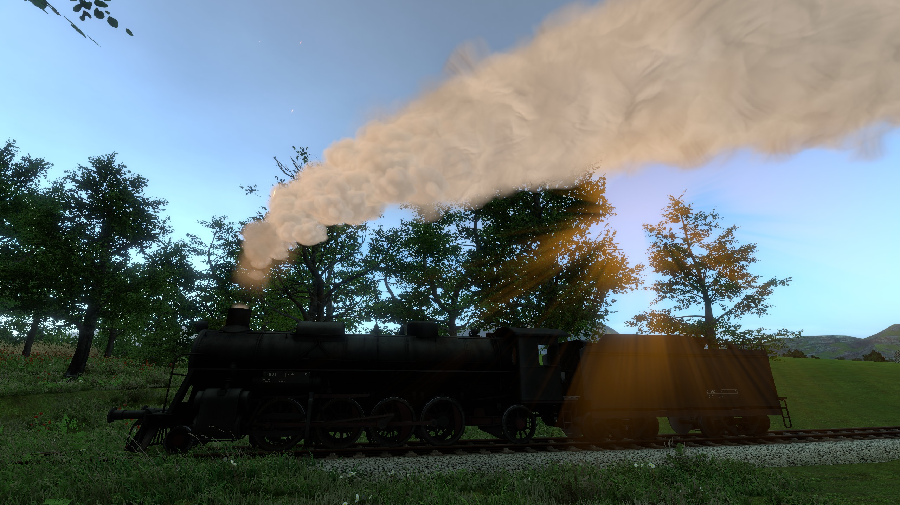

# Realistic Stack Effects for Derail Valley

**1.2.1** (2026-11-13): a hotfix: the steam around the engine follows its valve, so a blowdown cracked open blows a little and one wide open blows hard, whatever was opened first; the same for the whistle, safety valves, dynamo, and a cracked cylinder. An isolated game run opened the blowdown on a steamed S282 and FEF-3 to 10 % and 100 % in both orders, with Realistic Firing, which draws the same steam. Not run in game: this mod alone, this exact zip, VR, multiplayer, and the other sources at part opening.

**1.2.0** (2026-11-13): the chimney's exhaust let out beat by beat and attached at the stack's rim, white from the rim in damp air, and no longer in two colors on a smoky start; the engine's steam drawn behind the smoke where it is behind it; and an Auto smoke quality. The owner played private builds with the exhaust changes on the S282, with Realistic Firing. Isolated game runs on a clone of the game captured the exhaust with this mod drawing beside Realistic Firing, at High and Medium, and ran Auto stepping the smoke down and back up. Not run in game: this exact zip, this mod alone without Realistic Firing, engines other than the S282, VR, and live multiplayer.

**1.1.0** (2026-11-11): the engine's own steam drawn as the plume is, by the weather; better frame rates from the chimney smoke; and smoke and steam no longer lit by a set sun. The owner played the engine steam on the S282 in game, with Realistic Firing, in three private previews, and isolated game runs on a clone of the game captured it, at dusk among them. The frame-rate work was timed in game against Realistic Firing 1.17.9's plume on the code before it joined the engine steam; the joined build was checked by its builds and tests. Not run in game: this mod alone without Realistic Firing, engines other than the S282, the steam in a tunnel, VR, and live multiplayer.

**1.0.3** (2026-11-01): faint smoke and steam complete their fade. Verification is offline: model tests, adapter checks, builds and package checks. This fix has not been run in game, in VR or in live multiplayer.

**Realistic Firing's stack effects, for the stock locomotives.** This is
the same chimney smoke and steam as Realistic Firing, built from the same
code, as a mod of its own. It reads the game's own firebox, so it works on
the stock S282 and S060 (and Custom Car Loader steam engines) without
Realistic Firing or its firing simulation: a puff on every exhaust beat,
thrown up by the blast and rising as a buoyant plume that spreads, thins,
and drifts with the wind, its color taken from the fire and its white
steam from the weather.



## Install

Requires Unity Mod Manager 0.28.2 or newer. Tested on Derail Valley Build 99.

1. In Unity Mod Manager, open the Mods tab and install this zip, or
   extract the `RealisticStackEffects` folder into the game's `Mods` folder.
2. Start the game. The settings are in Unity Mod Manager's window
   (Ctrl+F10).

## What you see

- **A puff on every beat**, timed to the cylinders. Working hard, the
  puffs are thrown high in a narrow jet before they slow and billow;
  drifting, the stack goes quiet.
- **A plume that rises on its own heat**, hundreds of feet in still air,
  bent over by the wind and by the train's speed, spreading and thinning
  as it ages. Under a tunnel's roof it spreads along the roof instead.
- **Smoke colored by the fire.** A well-drawn fire shows a faint haze; a
  fire short of air smokes gray; a fresh shovelful smokes out dark for a
  few seconds, then clears. With plenty of air the stack runs clear.
- **Steam that follows the weather.** Little white on a hot, dry
  afternoon; big, lingering plumes on a damp dawn, in the rain, or in
  winter. With DV Seasons running, its season's temperature is used.
- **Heat shimmer** over a clean stack, and **cinders** on hard beats.
- **Steam around the engine:** the dynamo's, the cylinder cocks', the
  safety valves', the whistle's, the glands', and small leaks' steam,
  drawn as the plume is and by the same weather: long white trails on a
  frosty day, little or nothing on a hot, dry one.

## Engines

Every steam locomotive with the game's own chimney smoke, fired the
game's own way: the S282 and S060, and Custom Car Loader steam engines.
Each reads its own firebox:
how much smoke it makes, its heat, the air through it, and the coal
landing on it.

## With Realistic Firing

With Realistic Firing 1.16.0 or newer installed too, this mod draws the
smoke on every engine, and Realistic Firing feeds it the realistic fire:
its soot and smoke-out zone by zone, a stoker's lost fines and a shaken
grate's cinders, an oil burner's haze, a melted fusible plug's steam, and
wet steam from cold cylinders. Its smoke settings then give way to this
mod's. With an older Realistic Firing, this mod stays off and Realistic
Firing draws the smoke as before, until it is updated.

## Settings

- **Custom smoke effects** (restart required): off, the plume drives the
  game's own smoke particles.
- **Heat shimmer** (restart required).
- **Steam around the engine** (restart required): off, the game's own
  puffs stay.
- **Smoke quality**, for a slower graphics card: Medium draws the smoke
  at half resolution, Low with half as many puffs besides (in VR, or with
  forward rendering, half and a quarter as many puffs instead). Auto
  draws at High and lowers the quality only while the game runs under 45
  frames a second with smoke in the air and the lower quality helps.
- **Season** for the steam's air, when DV Seasons isn't running.

## Multiplayer

Draws only, so each player can run it or not; nobody else needs it. On a
guest it reads the host's engines; a guest's own shovelfuls smoke out,
another player's show in the fire's smoke.

## Building from source

Build with the .NET 10 SDK against your own installed game's assemblies:

```sh
dotnet build RealisticStackEffects.slnx -c Release -p:DvInstallDir="/path/to/Derail Valley"
dotnet test tests/RealisticStackEffects.Core.Tests -c Release
scripts/check-adapter.sh    # the stock firebox read as the game works it out (needs Mono)
scripts/build-fx.sh         # the effects bundle (Unity 2019.4.40f1, Python 3 with NumPy and Pillow)
scripts/check-assets.sh     # the bundle across Unity's scene and asset cleanup
scripts/package.sh          # test, build, and zip a release into dist/
```

`src/RealisticStackEffects.Shared` is the plume's source, shared with
Realistic Firing, which builds its own copy; `src/RealisticStackEffects`
is this mod, with its contract for other mods' fires
(`RealisticStackEffects.Api.StackSources`).

## License

MIT; see LICENSE. Source: https://github.com/Specter242/DVRealisticStackEffects
